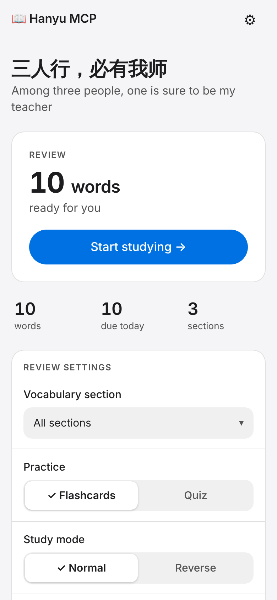
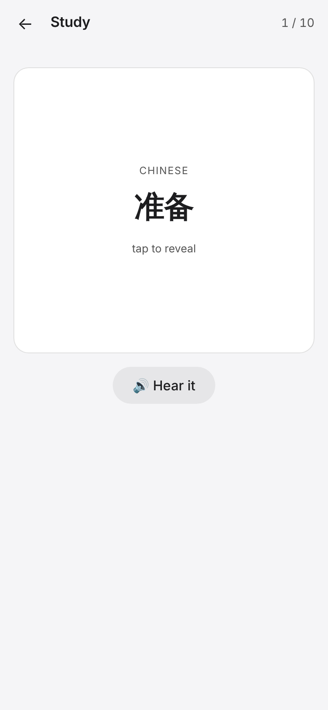
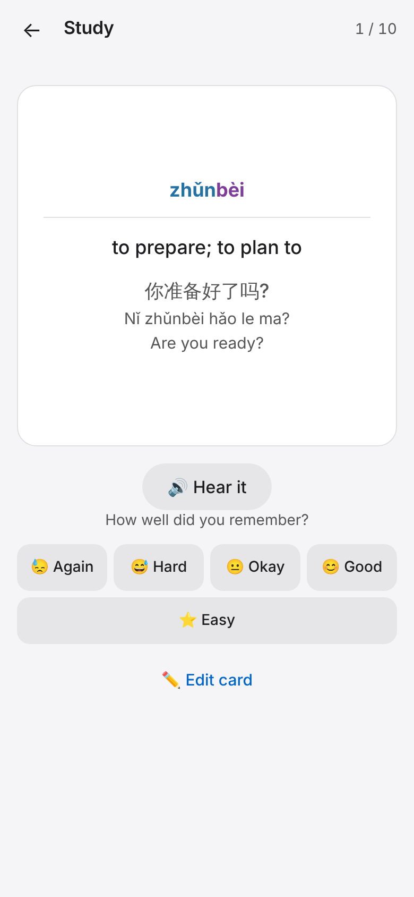
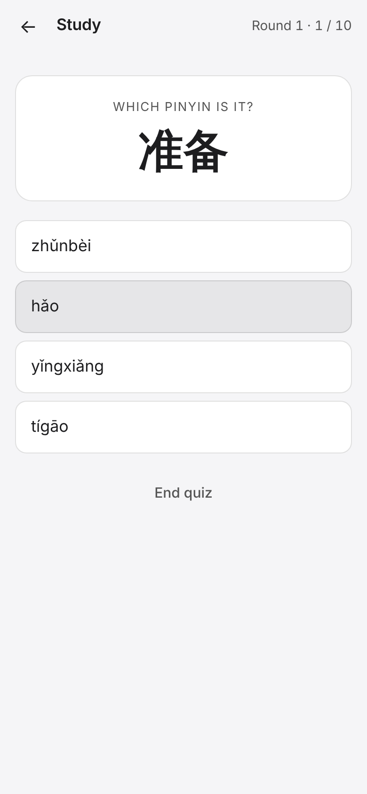

<div align="center">


# Hanyu MCP

### Learn Chinese vocabulary with Claude — and never forget it.

**Save words from any AI chat straight into a spaced-repetition flashcard app on your phone.**
Self-hosted · open source · Mandarin (hanzi, pinyin, tones) · SM-2 scheduling · MCP-native

[](https://modelcontextprotocol.io)
[](pyproject.toml)
[](backend/)
[](pwa/)
[](docs/deployment.md)
[](https://docs.astral.sh/ruff/)

[Quick start](#-quick-start) · [How it works](#-how-it-works) · [Features](#-features) · [Deploy](docs/deployment.md) · [Algorithm](docs/learning-algorithm.md)

</div>

---

<p align="center">
  
  
  
  
</p>

## Why Hanyu MCP?

Learning Chinese with an AI tutor works great — until the session ends and the new words vanish into chat history. Copying them into a flashcard app by hand is tedious, so most people never do it.

**Hanyu MCP closes that gap.** Say *"wrap up and save today's vocab"* and your assistant pushes every new word — with pinyin, meaning and a context-rich example sentence — into your own review deck. Later, you study it on your phone, and the SM-2 spaced-repetition algorithm schedules each card for the moment you are about to forget it.

## The numbers

| | |
|---|---|
| **4** MCP tools | `add_vocabulary`, `bulk_add_vocabulary`, `add_hanzi`, `delete_session` |
| **50** words per call | Save an entire lesson in a single request |
| **1 → 6 → 15 → 38 days** | Review intervals after consecutive Good, Good, Good, Easy ratings (SM-2) |
| **2** independent schedules | Forward (hanzi → meaning) and reverse (pinyin → hanzi) progress are tracked separately |
| **4** quiz question types | Hanzi → meaning, hanzi → pinyin, meaning → hanzi, sound → hanzi |
| **0** build steps, **0** frontend dependencies | The PWA is plain HTML, CSS and JavaScript |
| **200+** automated tests | Backend and MCP server, plus a weekly dependency security audit |

## ✨ Features

**For learners**

- 🧠 **Spaced repetition (SM-2)** — cards resurface at growing intervals; one lapse resets the streak but keeps your ease factor.
- 🔄 **Normal and reverse study modes** — recognise the hanzi, or recall it from pinyin. Each direction keeps its own schedule.
- 🎯 **Endless mixed quiz** — multiple-choice practice that never touches your flashcard progress.
- 🔊 **Mandarin text-to-speech** — words and example sentences are spoken after you answer, never before (no spoilers).
- 🌈 **Tone-coloured pinyin** — see the tones at a glance.
- 📖 **Context-first example sentences** — every card stores hanzi, pinyin and translation separately.
- 🈶 **Heisig-style hanzi cards** — single-character cards with a keyword and tone; re-saving enriches the card and keeps your schedule.
- 🗂 **Vocabulary sections** — group words by lesson, topic or HSK level and study one section at a time.
- ✏️ **Edit and browse** — fix a card on the fly or review everything you have saved.
- 📱 **Installable PWA** — add it to your iOS or Android home screen; a service worker keeps the app shell available offline.

**For builders**

- 🔌 **MCP-native** — a remote MCP server that any client with OAuth 2.1 support can use (Claude.ai, ChatGPT and others).
- 🔐 **Real authentication** — OAuth 2.1 with PKCE and Dynamic Client Registration on the MCP server, an API key between services, and a JWT for the PWA. The API key never reaches the browser.
- 🧩 **Small, readable stack** — FastAPI + SQLite, no ORM, no frontend build tooling.
- ⚙️ **Duplicate-safe bulk import** — repeated words are skipped and reported.

## 🔧 How it works

```
 You ──► "Save today's words"
          │
          ▼
   AI assistant (Claude, …)
          │  MCP tools over OAuth 2.1
          ▼
   MCP server ──────────────►  Backend API (FastAPI)  ──►  SQLite
                                      ▲
                                      │  /api proxy (Cloudflare Pages Function)
                                      │
                         PWA flashcards & quiz on your phone
```

| Component | Folder | Role |
|-----------|--------|------|
| Backend API | [`backend/`](backend/) | FastAPI + SQLite REST API, SM-2 scheduling, JWT and API-key auth |
| MCP server | [`mcp-server/`](mcp-server/) | Exposes the vocabulary tools to AI assistants; OAuth 2.1 authorization server |
| PWA | [`pwa/`](pwa/) | Flashcards, quiz, browse, audio — installable on your phone |
| Proxy | [`functions/api/`](functions/api/) | Forwards `/api/*` to the backend so no secret ships to the browser |

## 🚀 Quick start

You need [`uv`](https://docs.astral.sh/uv/) and Python 3.12+.

### 1. Run the backend

```bash
cd backend
uv sync

# Create a .env file
echo "API_KEY=$(openssl rand -hex 32)" > .env
echo "PWA_PASSWORD=choose-a-passphrase" >> .env
echo "DATABASE_PATH=./vocab.db" >> .env

uv run --env-file .env uvicorn main:app --reload
```

The API runs at `http://localhost:8000`, with interactive docs at `/docs`.

<details>
<summary><b>Try the REST API with curl</b></summary>

```bash
export API_KEY=<your-key>

curl http://localhost:8000/health

# Add a word
curl -X POST http://localhost:8000/vocabulary \
  -H "X-API-Key: $API_KEY" -H "Content-Type: application/json" \
  -d '{"word":"变化","pinyin":"biànhuà","definition":"change; variation","example":"这座城市的变化很大。","example_pinyin":"Zhè zuò chéngshì de biànhuà hěn dà.","example_translation":"This city has changed a lot.","language":"Chinese"}'

# Words due for review
curl http://localhost:8000/vocabulary/due -H "X-API-Key: $API_KEY"

# Submit a review (quality 0–5)
curl -X PATCH http://localhost:8000/vocabulary/1/review \
  -H "X-API-Key: $API_KEY" -H "Content-Type: application/json" \
  -d '{"quality":4}'
```

Other endpoints: `GET /vocabulary`, `POST /vocabulary/bulk`, `POST /vocabulary/hanzi/bulk`, `PATCH /vocabulary/{id}`, `DELETE /vocabulary/{id}`, `GET /sessions`, `DELETE /vocabulary/session/{id}`.

</details>

### 2. Run the MCP server

```bash
cd mcp-server
uv sync

cat > .env <<EOF
VOCAB_API_URL=http://localhost:8000
VOCAB_API_KEY=<same value as the backend API_KEY>
MCP_SECRET=$(openssl rand -hex 32)
ISSUER_URL=http://localhost:8080
DATABASE_PATH=./oauth.db
EOF

uv run --env-file .env python server.py
```

To use it from Claude.ai, ChatGPT or another remote-MCP client, deploy it to a public HTTPS URL and add that URL as a custom connector. The client discovers the OAuth endpoints automatically and you sign in with `MCP_SECRET`. Then just ask:

> *"Save 变化 (biànhuà, "change") to my vocab deck with an example sentence."*

### 3. Open the PWA

The PWA calls `/api/*` on its own origin, which is forwarded to the backend by [`functions/api/[[path]].js`](functions/api/%5B%5Bpath%5D%5D.js). Deploy `pwa/` (with the `functions/` folder) to **Cloudflare Pages** and set `BACKEND_URL` to your backend. Log in with your `PWA_PASSWORD`.

HTTPS is required for service workers and "Add to Home Screen":

- **iOS:** Safari → Share → Add to Home Screen
- **Android:** Chrome → menu → Install app

Full production walkthrough (Railway + Cloudflare Pages): **[docs/deployment.md](docs/deployment.md)**.

## 🤖 Make your AI tutor a better note-taker

[`docs/skills/chinese-vocab-push/SKILL.md`](docs/skills/chinese-vocab-push/SKILL.md) is a ready-made Claude skill. At the end of a tutoring session it asks whether you want regular word cards or single-character Heisig cards, then saves every word with pinyin and an example sentence that shows *how* the word is used.

## 📚 Documentation

| Guide | What's inside |
|-------|---------------|
| [Deployment](docs/deployment.md) | Secrets, Railway, Cloudflare Pages, OAuth connection, smoke test |
| [Learning algorithm](docs/learning-algorithm.md) | SM-2 maths, quality scores, study modes, quiz and audio behaviour |
| [Architecture](docs/architecture.md) | Original design notes and data flow |

## 🔒 Security notes

- The PWA only talks to the backend through the server-side `/api` proxy; the backend API key is never exposed to the browser.
- Keep `API_KEY`, `MCP_SECRET`, `PWA_PASSWORD` and `BACKEND_URL` in your hosting platform's environment variables — never commit them.
- The backend allows all CORS origins by default; restrict it to your PWA domain after deployment if you like.
- CI runs a weekly `uv audit` on both Python packages.

## 🛠 Development

```bash
cd backend    && uv sync && uv run pytest
cd mcp-server && uv sync && MCP_SECRET=test VOCAB_API_KEY=test uv run pytest
```

Linting and formatting use [Ruff](https://docs.astral.sh/ruff/) (Python) and [Biome](https://biomejs.dev) (JavaScript) via pre-commit.

---

<sub>Keywords: learn Chinese, Mandarin flashcards, HSK vocabulary, spaced repetition, SM-2, Heisig, pinyin, hanzi, MCP server, Model Context Protocol, Claude, AI language tutor, self-hosted, FastAPI, progressive web app.</sub>
